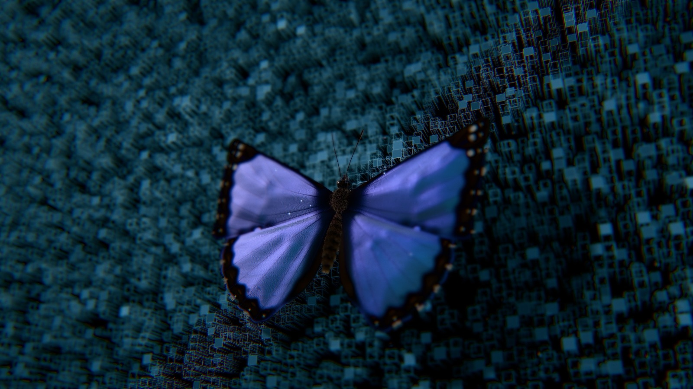

# butterfly

English | [日本語](README.ja.md)

**[Open the demo](https://butterfly.shunyakoide.com)**



A blue morpho butterfly resting on a wall, drawn with three.js and WebGPU. There are no model files or image textures: the shape, patterns, structural color and even the hairs are all made in code. Values such as the wing's blue and the wingbeat come from papers where possible, and the code comments give the source of each.

## Highlights

- **A different butterfly each time:** every page load picks one of seven Morpho species (peleides, menelaus, achilles, helenor, rhetenor, cypris, sulkowskyi) and draws its upper and under sides to match. The wing and body shapes stay those of peleides.
- **A blue that changes with the angle:** the blue isn't a pigment. It's computed as structural color, from thin-film interference in the scales, so its hue and brightness change with the view and the light.
- **Lifelike behavior:** it walks on four legs to turn its back to the sun, and now and then takes a few steps. Touch it and it flies off, then returns a little later. Left alone, it takes off by itself after 30 to 90 seconds.
- **Digital walls:** only the butterfly is meant to look real. There are three walls to choose from:
  - Columns: square columns drawn in glowing lines. Under the butterfly their tops level out into a platform, which sinks when it flies off and rises again when it returns.
  - Circuit: layers of amber circuitry running into the distance, with pulses of light.
  - Glass: stacked silver-white glass boxes, like a crystal.

## Running it

```bash
npm install
npm run dev
```

Open it in a browser with WebGPU support (Chrome, Edge, Safari 26 or later, and others). Without WebGPU it draws with WebGL2. The sky lighting is downloaded at runtime, so it needs a network connection.

## Controls

The camera is fixed.

| Input | Action |
|---|---|
| Tap the butterfly | It flies off |
| Drag | Moves the sun (the butterfly turns to follow) |
| WALL at the bottom left, or the W key | Wall: columns / circuit / glass |
| FX at the bottom left, or the E key | Redraws the screen: off / scan / dither |
| PRINT at the bottom left, or the D key | How the butterfly is drawn: off / green stipple / blue halftone / black dots on white / chrome / hologram / contour lines / thermal |

The FX modes:

- scan: points, lines and readouts tracking the butterfly, with thermal and X-ray style zoom windows
- dither: turns the whole screen into a grey hexagonal dot screen, with Morpho-blue characters blinking on a grid

Always on: at take-off the butterfly breaks into flowing blocks, and star-shaped glints (scales) twinkle as they fall from its wings.

## URL parameters

| Parameter | Values | Meaning |
|---|---|---|
| `species` | `peleides` `menelaus` `achilles` `helenor` `rhetenor` `cypris` `sulkowskyi` | Opens with that species |
| `pose` | `open` `closed` | Holds the wings still at rest |
| `wear` | `0` to `1` | How worn the wings are |
| `sun` | `azimuth,elevation` (degrees) | Sun direction |
| `slow` | above `0`, up to `1` | Slow motion (for example `0.1`) |
| `wall` | `circuit` `glass` | Starts with that wall |
| `fx` | `scan` `dither` (`on` means scan) | Starts with FX on |
| `print` | `dots` `halftone` `pixels` `chrome` `holo` `topo` `thermal` | Starts with that drawing style |
| `perf` | none | Shows the frame rate and GPU time per frame at the bottom left. `window.app` lets you switch parts off to compare their cost |

## Files

| File | Contents |
|---|---|
| `main.js` | Scene, walls, lights, environment light, post-processing, controls, main loop |
| `flight.js` | The butterfly's behavior (where it rests, walking on the wall, take-off and return, wing motion) |
| `butterfly.js` | Assembling the butterfly and moving its wings |
| `wing.js` | Wing shape, veins, relief |
| `pattern.js` | Each species' wing pattern parameters and drawing |
| `morpho.js` | Material for the blue structural color (interference reflection per scale) |
| `body.js` | Body, hairs, compound eyes, antennae, jointed legs |
| `rift.js` | The columns wall and the space behind it |
| `circuit.js` | The circuit wall |
| `glass.js` | The glass wall |
| `fx.js` | FX (screen redraws and overlays) |
| `digital.js` | Switching how the butterfly is drawn (D), and its break-up at take-off |
| `motion.js` | Glints falling from the wings (scales) |
| `noise.js` | Noise and random numbers |
| `refs.html` | Reference photos for comparison (links to Unsplash, no images included) |

## Assets

The sky lighting is the Poly Haven HDRI [garden_nook](https://polyhaven.com/a/garden_nook) (CC0), loaded at runtime.

## License

[MIT](LICENSE)
